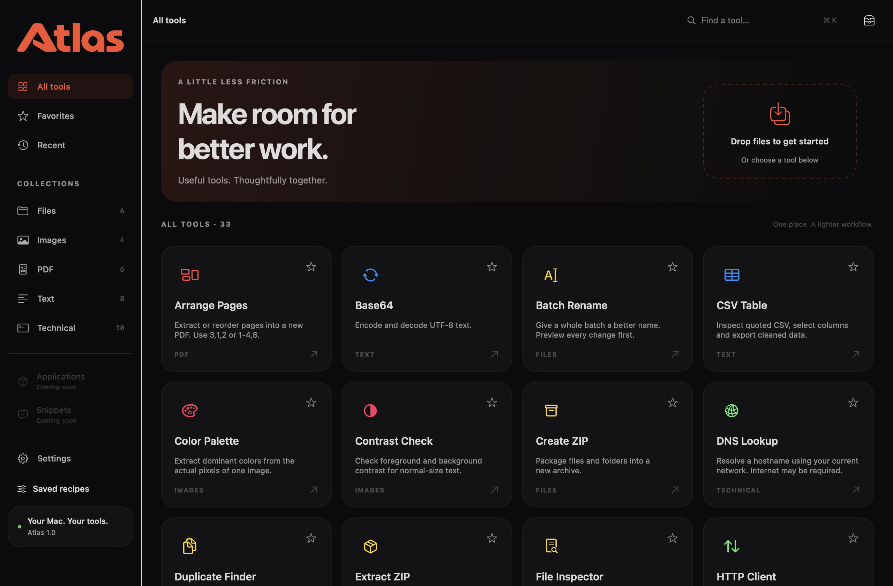
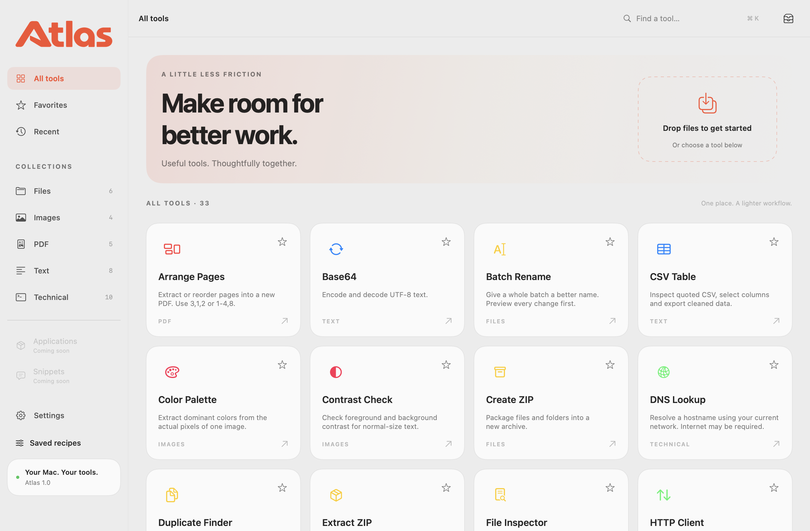
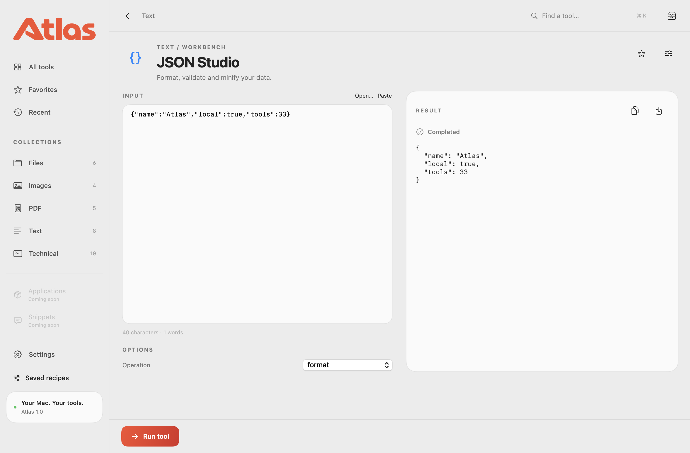

<div align="center">

# Atlas

### Useful tools. Thoughtfully together.

**A native macOS workspace powered by C# and .NET, presented in SwiftUI.**


[Tools](#tools) · [Build](#build) · [Development](#development) · [Contributing](CONTRIBUTING.md)

</div>



Atlas brings everyday file, image, PDF, text and technical tasks into one workspace. Find a tool, select your input and inspect the result. Processing runs locally; no account is required.

## Tools

| Collection | Features |
|---|---|
| **Files** | Batch rename with preview and undo records, duplicate detection, file checksums, ZIP creation and extraction. |
| **Images** | Batch resize and JPG/PNG/WebP conversion, metadata inspection and removal, output naming and ZIP, color palettes and contrast checks. |
| **PDF** | Merge, split, reorder and extract pages, create PDFs from images, extract selectable text. |
| **Text** | JSON formatting, text cleanup and comparison, ordered text recipes, CSV columns and deduplication, Markdown preview, Base64 and URL encoding. |
| **Technical** | JWT payload inspection, regex, hashes, UUIDs, timestamps, DNS, TLS, listening ports, HTTP requests and confirmed command execution. |

Favorites, recent tools, saved recipes and a sequential job queue support repeat work. Exports preserve original files. Successful jobs clear their input while keeping results; previews and failed jobs retain input for the next step.

<table>
<tr><td></td><td></td></tr>
<tr><td align="center">Light, dark or system appearance</td><td align="center">Input and results in one workspace</td></tr>
</table>

## Build

Requirements: **macOS 15+, Xcode 26+ with the macOS SDK, and .NET 10 SDK**. Liquid Glass is available on macOS 26+, with a material fallback on macOS 15.

```sh
dotnet restore src/Backend/Atlas/Atlas.sln
sh src/Scripts/build.sh
open src/Build/Atlas.app
```

The default development bundle uses the installed .NET runtime. See [third-party notices](THIRD_PARTY_NOTICES.md) for dependency licensing and Release build requirements.

## Development

The SwiftUI client sends structured requests to a local C# child process. The engine reports progress, results and errors through newline-delimited JSON; no local HTTP server is needed.

```text
src/
  Backend/Atlas/
    Core/                  request and result contracts
    Infrastructure/        C# tool implementations
    Presentation/          desktop process entry point
  Frontend/AtlasMac/        SwiftUI interface and local state
  Scripts/                 build and verification
  Docs/Screenshots/        application previews
```

```sh
sh src/Scripts/check.sh
python3 src/Scripts/http-check.py
```

Checks cover processing, file preservation, validation, cancellation and the Swift–C# connection. Screenshots are rendered from the app's views using synthetic data.

## Local data

Preferences and explicitly saved recipes stay on your Mac. Working inputs and job results last for the current session. Network tools use the network when requested; commands run with your account's permissions and require confirmation. Settings export is an explicit action and may include values you saved in recipes.

## Contributing

See [CONTRIBUTING.md](CONTRIBUTING.md) for setup and pull request guidelines. Atlas source is available under the [MIT License](LICENSE); dependencies retain their own licenses.
